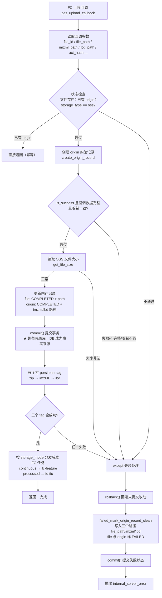
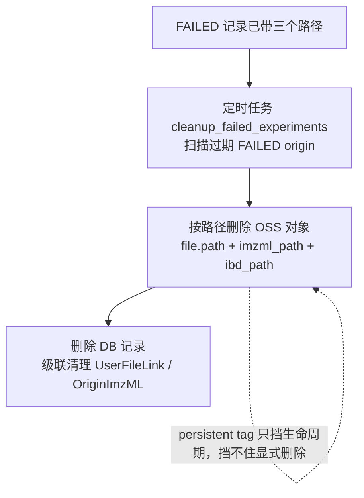

# OSS 上传回调流程

本文档描述当前 FC 上传完成回调（`oss_upload_callback`，[api/callback_api.py](../api/callback_api.py)）的处理流程，以及失败时如何避免 OSS 孤儿对象。

## 主流程图

## 失败对象的回收（孤儿防范）

## 关键设计点

1. **先 commit 后打 tag**：路径在第 1 次 `commit()` 就已落库。之后无论哪一步打 tag 失败，三个路径都在 DB 中，`cleanup_failed_experiments` 能据此删除对象，不会产生孤儿。
2. **失败兜底带路径**：`failed_mark_origin_record_clean` 显式接收并写入 `file_path / imzml_path / ibd_path`。因为打 tag 失败前的 `rollback()` 会冲掉正常流程里赋给 origin 的路径，这里补写保证路径不丢。
3. **孤儿根治靠"路径落库 + 按路径删除"**：persistent tag 只影响 OSS 生命周期规则是否回收对象，不影响显式 `delete` 调用，因此已打 tag 的对象也能被清理任务删除。
4. **幂等**：回调开头检查"已有 origin 则直接返回"，FC 重发回调不会重复建实验。

## 两种"打 tag 与 commit"顺序的对比

| 维度 | 先 commit 后打 tag（当前） | 先打 tag 后 commit（原始） |
| --- | --- | --- |
| happy path DB 写次数 | 1 次 commit | 1 次 commit |
| tag 失败时 DB 写次数 | 2 次（COMPLETED→FAILED） | 1 次（直接 FAILED） |
| 路径持久化保障 | DB 本身保证，兜底是双保险 | 依赖 `failed_mark_origin_record_clean` 必须成功 |
| 孤儿风险（配现有兜底） | 无 | 无 |
| 特有的小缝 | commit 成功但打 tag 前进程崩 → 对象未打 tag 被生命周期回收，DB 误标 COMPLETED（可重传） | commit 失败（DB 故障）→ 已打 tag 但无 DB 记录 |

> 结论：两种顺序在配上"失败带路径 + cleanup 按路径删除"后都不会产生孤儿。当前采用"先 commit 后打 tag"，让 DB 先成为事实来源、失败处理更稳，代价仅是 tag 失败这条低频路径上多一次 DB 写。
