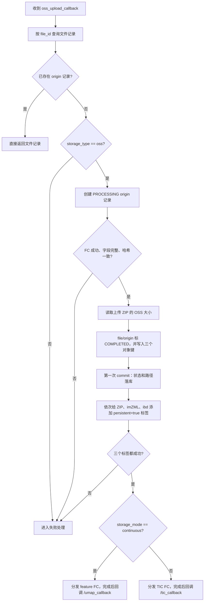
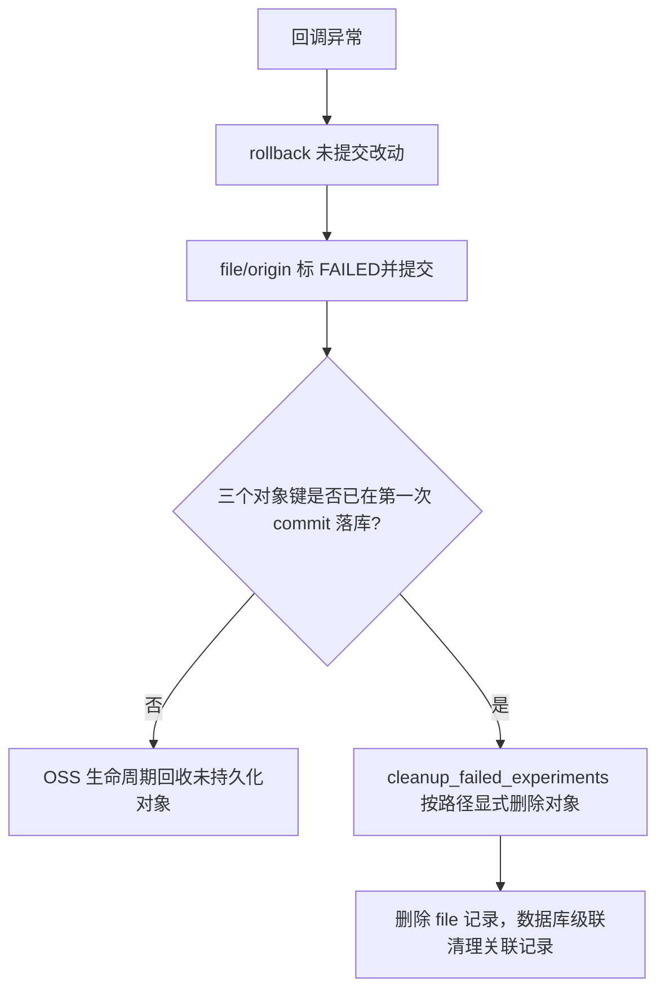

# OSS 上传回调流程

本文档以 [api/callback_api.py](../../api/callback_api.py) 和 [background/file_background.py](../../background/file_background.py) 的当前实现为准，说明上传对象约定、回调事务边界和失败回收方式。

## 对象键与回调约定

- 上传 ZIP：`{oss_zip_storage_root}/{file_id}/{file_verify_code}.zip`
- 解包产物：`{oss_origin_storage_root}/{file_id}/{file_verify_code}/{原始文件名}.imzML/.ibd`
- 上传完成回调：`POST /callback/oss_upload_callback`
- 所有 `/callback/*` 请求都必须携带 `X-FC-Token: <FC_CALLBACK_TOKEN>`。

解包 FC 从上传对象键解析 `file_id`。成功回调必须提供 `file_id`、`file_path`、`is_success=true`、`act_hash`、`imzml_path`、`ibd_path`、`imzml_size` 和 `ibd_size`。失败回调允许 `file_path` 为空，并通过 `error_type` 报告原因。

## 成功流程

图像 FC 接收的目标目录为 `images/file_{file_id}/`，TIC/UMAP 回调写入 `FileInDB.image_path` 的值必须是完整对象键，当前约定为 `images/file_{file_id}/preview.jpg`。

## 失败处理与对象回收

异常分支会先 `rollback()`，随后调用 `failed_mark_origin_record_clean`，把仍可用的 file/origin 记录标为 `FAILED` 并再次提交。该函数只更新状态和错误信息，不重新补写 OSS 路径，也不会立即删除对象。

失败时按事务发生位置分两类：

1. **第一次 commit 之前失败**：数据库中不保证留有 ZIP、imZML、ibd 的完整路径。此时对象尚未获得完整的 `persistent=true` 标签，主要依赖 OSS 生命周期规则回收。
2. **第一次 commit 之后打标签失败**：三个路径已经落库，即使随后回滚也不会丢失。`cleanup_failed_experiments` 处理到该记录时，会按 `file.path`、`origin.imzml_path`、`origin.ibd_path` 尝试显式删除对象，再删除数据库记录。显式删除不受 `persistent=true` 标签影响。

## 幂等与边界

- 回调开头只要发现该 `file_id` 已有关联 origin 记录就直接返回，不区分 origin 当前状态；FC 重试不会重复创建 origin。
- 数据库在第一次 commit 后、对象打标签前如果进程退出，文件可能暂时保持 `COMPLETED` 而标签不完整；当前代码没有单独的修复任务处理这个窗口。
- `cleanup_stale_preflights_all_users` 也会匹配过期的 `FAILED` 文件，但它只删除数据库记录。如果它先于 `cleanup_failed_experiments` 处理一条带持久化标签的失败记录，或者显式 OSS 删除失败，对象可能残留；当前实现不能宣称失败路径绝对没有孤儿对象。
- 从未到达后端回调的上传对象没有应用层对象删除入口，必须配置 OSS 生命周期规则作为兜底。
