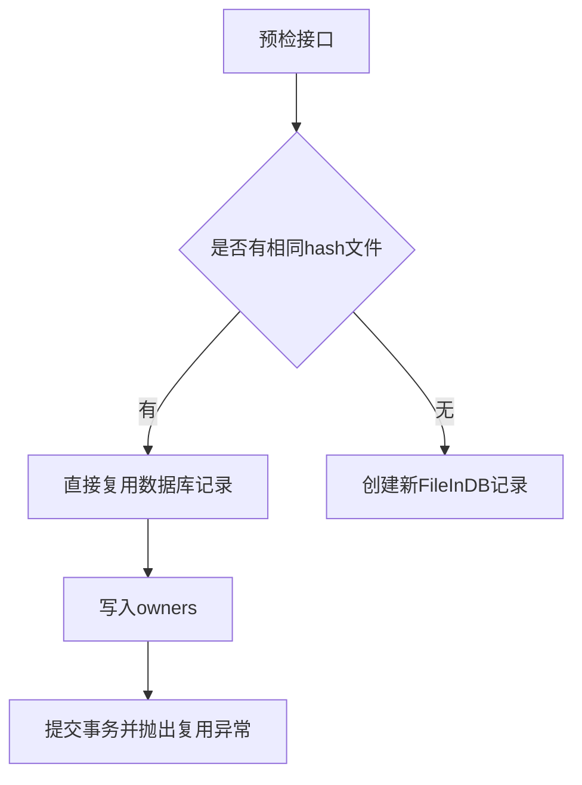
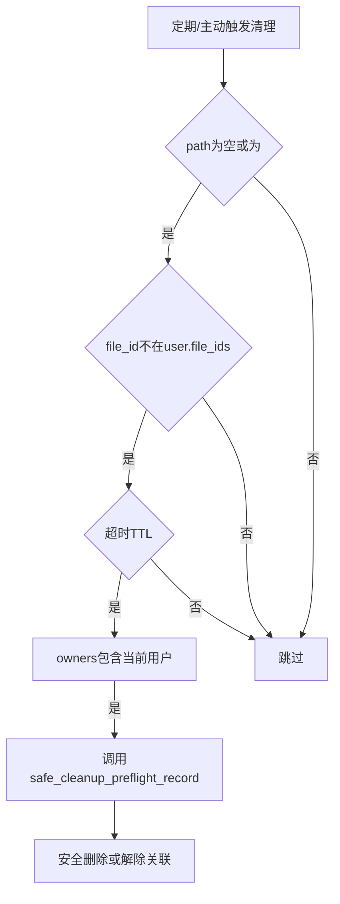
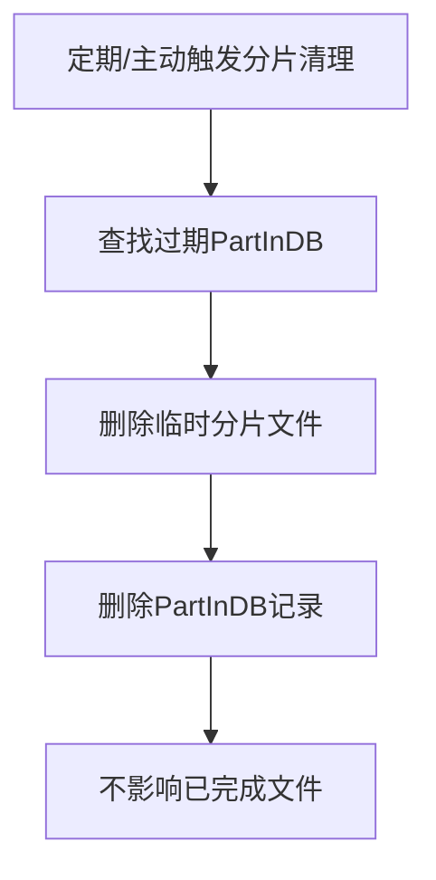

# 文件管理与分片上传 API 说明（2026）

> 适用于 FastAPI + SQLModel 实现的多用户文件上传系统，支持普通上传、分片上传、文件复用、预检、清理、实验文件判定等。

---

## 1. 设计目标

- 支持小文件一次性上传、大文件分片上传
- 避免重复存储（基于 SHA256 的文件复用）
- 支持多用户共享同一物理文件
- 强一致性：**文件是否完成 = 是否写入 user.file_ids**
- 安全清理：不会误删仍被其他用户引用的文件
- 支持实验文件（如imzML）与业务状态联动

---

## 2. 核心设计与判定标准

- **所有上传必须先预检（Preflight）**
- **FileInDB 表示“物理文件”**
- **User.file_ids 表示“用户真正拥有的文件”**
- **owners 是弱归属，用于预检 / 复用 / 权限判断**
- **只有上传成功后才写 user.file_ids**
- **imzML等实验型文件，只有实验表有记录且 status=COMPLETED 才视为真正上传**
- **特殊占位符 <SOURCE_PATH_CLEARED> 用于标记已删除但逻辑保留的路径**

---

## 3. 数据模型（核心字段）

### 3.1 FileInDB（文件表）
| 字段           | 说明                   |
| -------------- | ---------------------- |
| file_id        | 文件唯一 ID            |
| filename       | 文件名                 |
| path           | 物理存储路径/占位符    |
| hash_sha256    | 文件内容 hash          |
| size           | 文件大小               |
| owners         | 关联的用户 ID 列表     |
| storage_type   | local                  |
| total_parts    | 分片总数（仅分片上传） |
| uploaded_at    | 创建时间               |
| download_count | 下载次数               |

### 3.2 UserInDB（用户表）
| 字段            | 说明                       |
| --------------- | -------------------------- |
| username        | 用户名字                   |
| active          | 是否激活                   |
| identity        | 身份（管理员/普通用户）    |
| id              | 主键                       |
| email           | 邮箱                       |
| hashed_password | hash加密的密码             |
| file_ids        | 用户拥有的文件 ID 列表     |
| file_count      | 文件数量                   |
| total_file_size | 已用存储空间               |
| download_used   | 下载次数                   |

### 3.3 PartInDB（分片表）
| 字段            | 说明                  |
| --------------- | --------------------- |
| part_id         | 主键                  |
| file_hash       | 对应文件 hash         |
| part_number     | 分片序号（从 1 开始） |
| part_hash       | 分片 hash             |
| part_size       | 分片大小              |
| temp_path       | 临时分片路径          |
| owner_id        | 上传用户              |
| upload_at       | 上传时间              |
| file_id         | 所属文件的id          |
| total_file_size | 总文件的大小          |
| total_parts     | 文件的总片数          |

---

## 4. 普通上传流程（Simple Upload）

### 4.1 预检接口
- **POST /preflight_create_file**
- 参数：filename, hash_sha256, size, storage_type
- 行为：
  - 校验文件元数据（hash、size），其他参数在预检已完成
  - 检查用户是否已有同名/同内容文件（预检已完成）
  - 如发现已有相同 hash 文件 → 直接复用（写 owners，不再检查物理路径是否存在，直接提交事务并抛出复用异常，用户无需上传）
  - 否则创建新的 FileInDB 记录
  - 路径不存在，**不会写 user.file_ids**
- 返回：file_id、是否复用、异常信息

### 4.2 上传接口
- **POST /upload_simple_file**
- 参数：pre_file_id, file
- 校验：只校验文件 size/hash 是否与预检一致
- 成功后：写入物理文件，更新 user.file_ids、file_count、total_file_size
- 失败：清理预检记录
- 响应：文件信息/异常

---

## 5. 分片上传流程（Chunked Upload）

### 5.1 分片预检接口
- **POST /preflight_create_chunked_file**
- 参数：filename, hash_sha256, size, total_parts
- 行为：
  - 校验 total_parts > 0
  - 校验用户配额
  - 清理过期预检/分片记录
  - 如发现已有相同 hash 文件 → 直接复用（同上）
  - 否则创建 FileInDB（含 total_parts）
- 返回：file_id、是否复用、异常信息

### 5.2 上传分片接口
- **POST /upload_file_chunk**
- 参数：file_hash, part_number, part_hash, chunk
- 流程：
  1. 校验分片编号合法
  2. 校验 file_hash 对应的 FileInDB 存在
  3. 校验用户在 owners 中
  4. 校验分片未重复上传
  5. 保存分片到临时目录
  6. 写入 PartInDB
  7. 检查是否可以合并
- 合并校验：分片数量==total_parts，编号连续，所有分片文件存在
- 合并成功：写入物理文件，删除分片，更新 user.file_ids
- 失败：清理所有分片和文件记录

------

## 6. 文件复用机制


### 6.1 复用流程


### 6.2 复用判定
- 只要 hash_sha256 完全一致即可复用，不再检查物理文件路径是否存在。
- 复用时不会重复写磁盘，仅更新 FileInDB.owners，上传完成后再写 user.file_ids。


## 7. 清理机制


### 7.1 预检清理流程


### 7.2 分片清理流程


### 7.3 占位符处理
- delete_local_file 遇到 <SOURCE_PATH_CLEARED> 直接跳过，不会报错。

------

## 8. 权限模型

### assert_file_owner 规则

- 管理员直接放行
- 用户在 FileInDB.owners 中
- 或 file_id 在 user.file_ids 中

------

## 9. Swagger / 调试说明

### Swagger 的限制

- Swagger UI **不支持自动分片**
- 分片测试需：
  - 手动切文件
  - 或使用脚本 / 前端代码

### 推荐测试方式

1. Python 分片脚本
2. 前端 Blob.slice()

------

## 10. 典型状态机总结

```
NEW (preflight)
 ↓
UPLOADING (chunks)
 ↓
MERGING
 ↓
COMPLETED (user.file_ids 写入)

失败 → CLEANUP
```

------

## 11. 总结

该文件系统具备：

- ✔ 强一致性
- ✔ 支持大文件
- ✔ 文件复用（不再依赖物理路径检查）
- ✔ 多用户共享
- ✔ 安全清理（支持占位符路径跳过删除）
- ✔ 易扩展（可接入对象存储）

**核心判断一句话**：

> 文件是否真正存在，对用户而言，以 `user.file_ids` 为准。

### 文件列表接口说明

- 只返回真正上传且实验完成的文件（imzML类型需对应 experiment status=COMPLETED）
- 其他类型文件直接视为已上传

