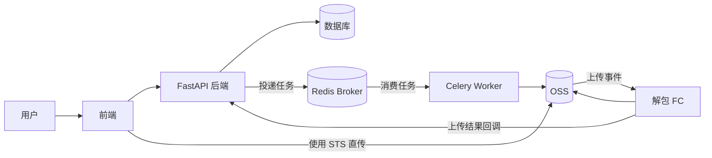
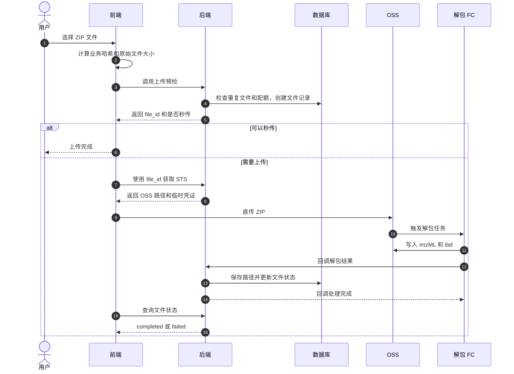
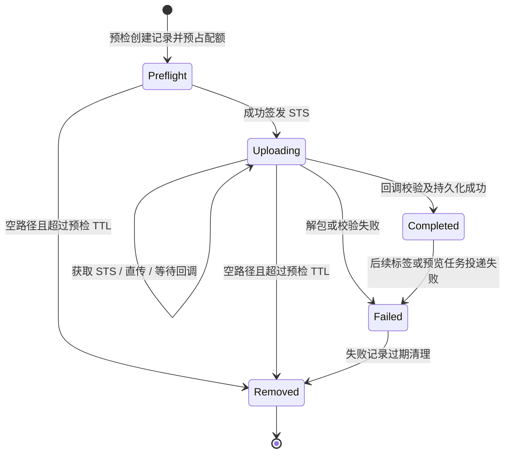

# 文件上传业务与 OSS 生命周期

本文档面向新接手的开发者，介绍文件上传业务的整体流程。当前系统只支持将 imzML 数据打包成 ZIP 后上传。回调事务、失败回收等实现细节见 [异步任务与回调架构](异步任务与回调架构.md)。

## 1. 业务目标

上传的文件内容不经过后端服务器，由前端直接上传到 OSS。后端只负责：

- 上传前检查文件信息、重复文件和用户配额。
- 创建文件记录并签发 OSS 临时上传凭证。
- 接收函数计算（FC）的解包结果，维护文件状态。
- 清理失败和过期的上传记录及遗留对象。

这样可以避免大文件占用 API 服务的网络带宽和内存。

## 2. 整体架构

| 模块 | 职责 |
|---|---|
| 前端 | 计算文件哈希、调用预检、获取 STS、直传 OSS |
| FastAPI | 用户鉴权、文件记录、配额、状态和回调处理 |
| OSS | 保存上传 ZIP、解包后的 imzML/ibd 以及预览文件 |
| 解包 FC | 解压 ZIP、检查文件内容并回调后端 |
| Celery | 执行 OSS 操作和定时清理任务 |
| 数据库 | 保存文件、用户关联和解包结果 |

## 3. 核心 API

| API | 调用方 | 作用 |
|---|---|---|
| `POST /files/preflight` | 前端 | 上传预检，创建文件记录或完成秒传 |
| `POST /files/upload` | 前端 | 获取 OSS 上传路径和 STS 临时凭证 |
| `POST /files/upload_simple` | 前端 | 兼容上传入口，与 `/files/upload` 使用同一套逻辑 |
| `POST /callback/oss_upload_callback` | 解包 FC | 报告解包成功或失败 |
| `GET /files/{file_id}/metadata` | 前端 | 查询文件当前状态和基本信息 |

前端接口使用 Bearer Token 鉴权，FC 回调使用专用 Token 鉴权。

## 4. 上传流程

结合上图，几条关键规则：

- 预检通过即创建文件记录并占用用户配额；上传失败或过期后由清理任务退还。
- 如果其他用户已成功上传过相同文件，预检直接返回秒传（`is_reuse=true`），前端不应再调用上传接口。
- 需要上传时，前端用 `file_id` 换取 OSS 目标路径和 STS 临时凭证。凭证只对这一个对象有效，上传路径由后端指定，前端不能自行拼接。
- ZIP 直传成功后，OSS 事件触发解包 FC，将 imzML 和 ibd 写回 OSS 并回调后端。
- 后端校验通过后，文件状态才变为 `completed`；校验或解包失败则为 `failed`。

## 5. 文件状态

| 状态 | 含义 |
|---|---|
| 预检态（内部值为空字符串） | 已创建记录并预占配额，尚未成功签发 STS |
| `uploading` | 已成功签发 STS，正在上传或等待回调 |
| `completed` | 解包和校验完成，可以用于后续业务 |
| `failed` | 上传、解包或回调校验失败 |

OSS 直传成功不等于业务上传成功，客户端应以数据库状态 `completed` 为准。

## 6. 对象保留与清理

上传成功后，OSS 中保留三类核心对象：源 ZIP、解包出的 imzML 和 ibd，以及后续生成的预览图。imzML 和 ibd 是正式业务文件，长期保留；源 ZIP 可以在保留期后删除，需要下载时可以重新打包。

清理由应用定时任务和 OSS 生命周期规则共同完成：

- 长时间未上传、未收到回调或已过期的记录，由定时任务清理数据库记录并退还用户配额。
- 已知路径的失败对象由清理任务显式删除。
- 后端不知道完整路径的遗留对象，依赖 OSS 生命周期规则回收；成功上传的对象会被标记为持久保留，不受生命周期规则影响。

## 延伸阅读

回调事务边界、失败回收方式和幂等问题见 [异步任务与回调架构](异步任务与回调架构.md)。
