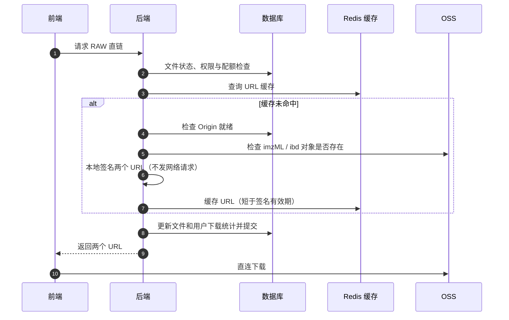
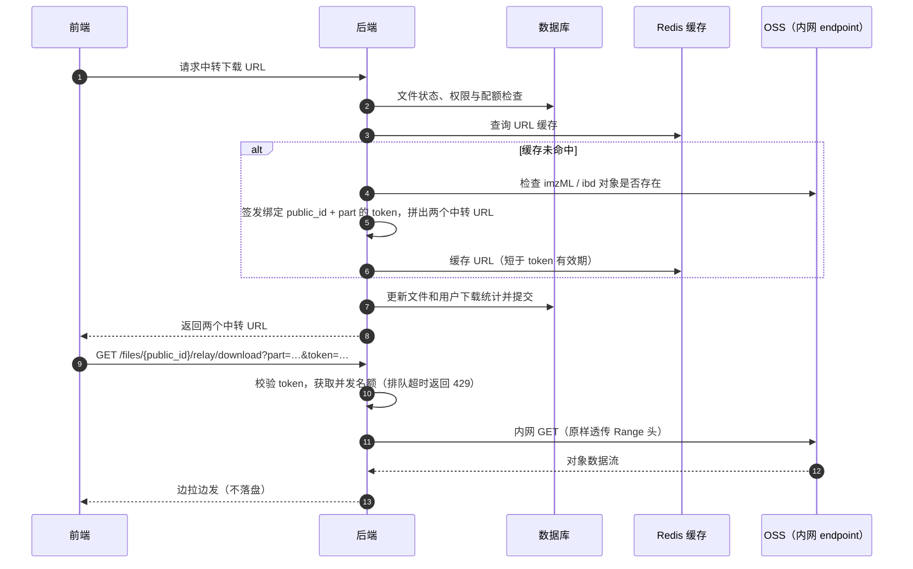

# 文件下载业务

本文档面向新接手的开发者，介绍文件下载业务的整体流程。下载只读取解包后的 imzML 和 ibd，有两种方式：**RAW 直链下载**（前端直连 OSS）和**中转下载**（经服务器流式透传）。ZIP 打包下载已下线。上游流程见[文件上传业务](核心业务API架构-文件上传.md)。

## 1. 业务目标

与上传对称，后端只负责校验、签名（或签发中转凭证）和统计：

- RAW 直链：为 origin 的 imzML 和 ibd 各签一个 OSS 预签名 URL，前端直连下载，毫秒级响应，无中间产物。
- 中转下载：返回两个指向后端的中转 URL，服务器经 OSS 内网 endpoint 拉取并边拉边发。OSS→服务器这一跳走内网不计费，省掉 OSS 公网下行流量。

上传的源 ZIP 不参与下载，超过保留期由定时任务 `cleanup_source_zips` 删除。

## 2. 下载方式对比

| 维度 | RAW 直链 | 中转下载 |
|---|---|---|
| 接口 | `GET /files/{public_id}/download_raw` | `GET /files/{public_id}/download_relay`，再访问返回的 `/files/{public_id}/relay/download` |
| 返回产物 | imzML + ibd 两个预签名 URL | imzML + ibd 两个中转 URL（内嵌短时 token） |
| 数据路径 | 前端直连 OSS | OSS 内网 → 服务器 → 前端 |
| 并发限制 | 无 | 每个进程最多 `relay_max_concurrency` 路，排队超时返回 429 |
| 下载配额 | 检查（免登录版除外） | 检查 |

另有免登录版 `GET /files/{public_id}/download_raw_noauth`：无登录态、不限次数、只更新文件维度统计，仅对公开文件开放，用于分享场景。

下载接口均以文件 `public_id` 标识文件（格式不合法直接返回 422），私有文件对非持有者一律按 404 处理。

## 3. RAW 直链流程

关键规则：

- 仅支持 `completed` 的 imzML 文件，签名前会确认 origin 对象真实存在。
- 预签名 URL 有有效期；有效期内重复请求直接复用缓存，避免反复签名。缓存有效期比 URL 有效期短，保证不会返回已过期的链接。
- 不产生任何中间产物，不改动文件记录的路径字段，与源 ZIP 清理任务无关。

## 4. 中转下载流程

关键规则：

- token 绑定 `public_id` 和 `part`，有效期与 RAW 签名 URL 相同，不能用于读取其他对象；token 可复用，断点续传和多线程下载器的并发 Range 请求共用同一个 URL。
- 下载端点凭 token 访问，不需要登录态；HEAD 只返回头部信息，不拉取正文。
- 并发名额覆盖整个传输过程；客户端超过 `relay_idle_timeout_seconds` 不消费数据时中断传输。
- 多个 uvicorn worker 时每个进程各自限流，实际并发为 worker 数 × `relay_max_concurrency`。

## 5. 配额与统计

- 下载次数配额：管理员不限，普通用户受下载次数上限约束，超限时拒绝。
- 统计是双维度的：文件维度记录累计下载次数和最近下载时间，用户维度记录已用下载次数，均为原子更新。
- 缓存命中仍然计一次下载，配额以“发起下载”为准。
- 文件的最近下载时间同时是源 ZIP 保留期的判定依据：`cleanup_source_zips` 删除最近下载时间早于保留期的源 ZIP。

## 延伸阅读

文件状态、origin 保留策略和对象清理见[文件上传业务](核心业务API架构-文件上传.md)。
