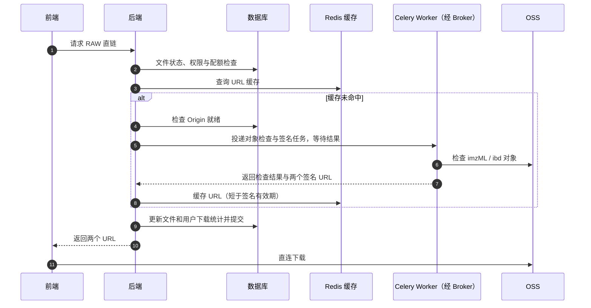
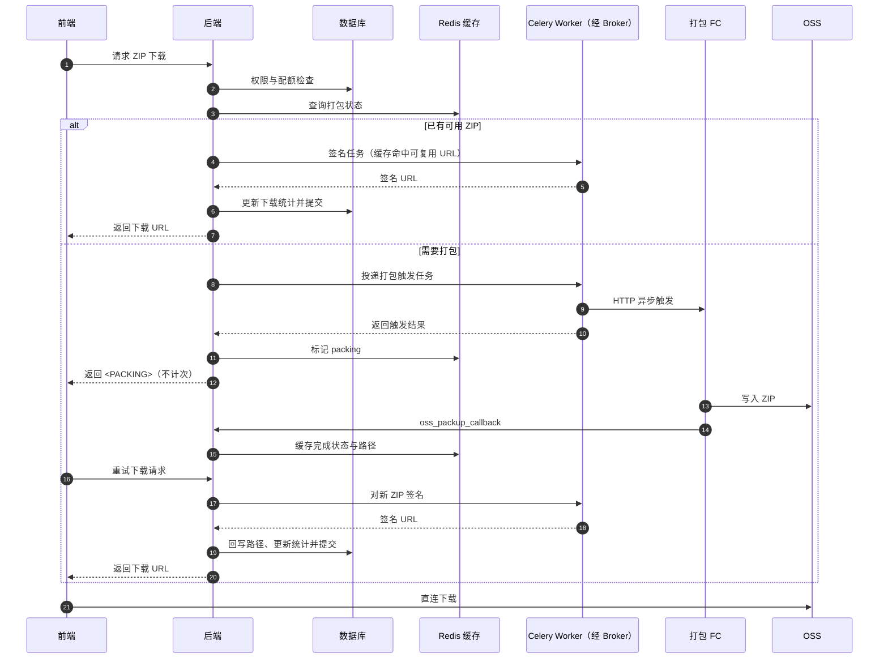

# 文件下载业务

本文档面向新接手的开发者，介绍文件下载业务的整体流程。系统有两套下载路径：**RAW 直链下载**和 **ZIP 打包下载**。当前前端使用的是 RAW 直链，ZIP 打包为存量路径，链路完整保留，用于后续扩展。上游流程见[文件上传业务](核心业务API架构-文件上传.md)。

## 1. 业务目标

与上传对称，下载的文件内容也不经过后端服务器，后端只负责校验、签名和统计：

- RAW 直链：为 origin 的 imzML 和 ibd 各签一个 OSS 预签名 URL，前端直连下载，毫秒级响应，无中间产物。
- ZIP 打包：把 origin 重新打包成单个 ZIP 再签 URL，适合需要单个压缩包的场景。

两套路径并存的业务依据是压缩率分流：上传回调会计算源 ZIP 与原始数据的压缩率，压缩率高时打包下载省流量，低时直链更直接。前端可据此决定走哪条路。

## 2. 下载方式对比

| 维度 | RAW 直链 | ZIP 打包 |
|---|---|---|
| 接口 | `GET /files/{public_id}/download_raw` | `GET /files/{public_id}/download` |
| 返回产物 | imzML + ibd 两个文件 | 单个 ZIP |
| 响应 | 立即返回 URL | 首次可能返回 `<PACKING>`，需重试 |
| 中间产物 | 无 | FC 打包的临时 ZIP |
| 下载配额 | 检查（免登录版除外） | 检查 |
| 当前状态 | 前端在用 | 存量保留，用于扩展 |

另有免登录版 `GET /files/{public_id}/download_raw_noauth`：无登录态、不限次数、只更新文件维度统计，用于公开文件分享场景。

下载接口均以文件 `public_id` 标识文件（格式不合法直接返回 422），私有文件对非持有者一律按 404 处理。ZIP 下载的响应不含内部 `file_id` 和 OSS 对象键 `path`（对象键同时含 `file_id` 与内容指纹），前端只使用 `oss_download_url`。

## 3. RAW 直链流程

关键规则：

- 仅支持 `completed` 的 imzML 文件，签名前会确认 origin 对象真实存在。
- 预签名 URL 有有效期；有效期内重复请求直接复用缓存，避免反复调 OSS 签名。缓存有效期比 URL 有效期短，保证不会返回已过期的链接。
- 缓存命中仍然计一次下载，配额以“发起下载”为准。
- 不产生任何中间产物，不改动文件记录的路径字段，与清理任务无关。

## 4. ZIP 打包流程

“已有可用的 ZIP”包含两种情况：上传的源 ZIP 尚未被清理，或之前的打包结果仍在缓存有效期内。需要打包的典型场景是源 ZIP 已过保留期被清理（imzML 和 ibd 长期保留，可以随时重打包）。

关键规则：

- `<PACKING>` 是约定的占位响应，表示打包正在进行，前端应间隔重试同一接口；并发请求不会触发重复打包。
- 打包产物按文件编号命名，与原始文件名解耦，同名文件不会互相干扰。
- 打包 ZIP 是临时对象：超过保留期没有被再次下载的，由定时任务删除对象并在记录中留下已清理标记，之后再次下载会自动重新打包。
- 返回 `<PACKING>` 时不消耗下载次数，成功拿到 URL 才计一次。
- 打包失败会清除失败状态，下次下载重新触发打包。

## 5. 配额与统计

- 下载次数配额：管理员不限，普通用户受下载次数上限约束，超限时拒绝签名。
- 统计是双维度的：文件维度记录累计下载次数和最近下载时间，用户维度记录已用下载次数，均为原子更新。
- 文件的最近下载时间同时是打包 ZIP 保留期的判定依据，活跃下载的 ZIP 不会被清理。

## 延伸阅读

文件状态、origin 保留策略和对象清理见[文件上传业务](核心业务API架构-文件上传.md)。
