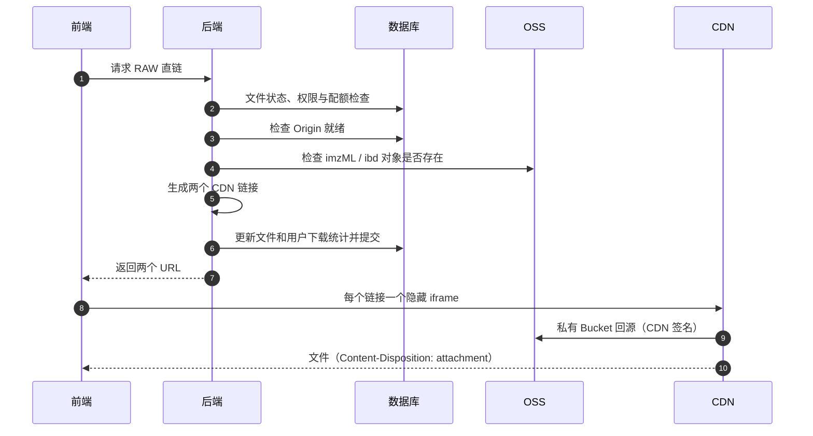
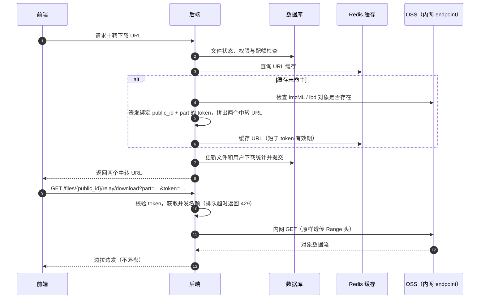

# 文件下载业务

本文档面向新接手的开发者，介绍文件下载业务的整体流程。下载只读取解包后的 imzML 和 ibd，有两种方式：**RAW 直链下载**（前端访问 CDN）和**中转下载**（经服务器流式透传）。ZIP 打包下载已下线。上游流程见[文件上传业务](核心业务API架构-文件上传.md)。

## 1. 业务目标

与上传对称，后端负责校验、生成链接和统计：

- RAW 直链返回 origin 的 imzML 和 ibd 的免签 CDN 链接。CDN 域名取 `oss_cdn_domain`，与 zarr 读取共用，未配置时两个接口都返回 `503`。
- 中转下载：返回两个指向后端的中转 URL，服务器经 OSS 内网 endpoint 拉取并边拉边发。OSS→服务器这一跳走内网不计费，省掉 OSS 公网下行流量。

上传的源 ZIP 不参与下载，超过保留期由定时任务 `cleanup_source_zips` 删除。

## 2. 下载方式对比

| 维度 | RAW 直链 | 中转下载 |
|---|---|---|
| 接口 | `GET /files/{public_id}/download_raw` | `GET /files/{public_id}/download_relay`，再访问返回的 `/files/{public_id}/relay/download` |
| 返回产物 | imzML + ibd 两个下载链接 | imzML + ibd 两个中转 URL（内嵌短时 token） |
| 数据路径 | OSS → CDN → 前端 | OSS 内网 → 服务器 → 前端 |
| 并发限制 | 无 | 每个进程最多 `relay_max_concurrency` 路，排队超时返回 429 |
| 下载配额 | 检查 | 检查 |

下载接口均以文件 `public_id` 标识文件（格式不合法直接返回 422），私有文件对非持有者一律按 404 处理。

## 3. RAW 直链流程

关键规则：

- 生成链接前检查 origin 状态，并对 imzML、ibd 各发一次 HEAD。数据库里是 COMPLETED 不代表对象还在（比如打 `persistent` 标签失败后被生命周期规则回收，或被手动删除）；对象缺失时直接返回 404，不扣配额，前端也能提示错误。RAW 不再缓存链接，这两次 HEAD 每次请求都会发。
- CDN 链接保留 `response-content-disposition=attachment`，由 CDN 向 OSS 回源。公开和私有文件均使用可转发的免签链接。登录、权限和配额检查发生在获取链接的 API 上。
- 前端为每个链接起一个隐藏 iframe，靠 CDN 返回的 `Content-Disposition: attachment` 触发下载。CDN 出错时页面不会有任何提示，排查"下载没反应"时先用 curl 直接请求链接。
- 不产生任何中间产物，不改动文件记录的路径字段，与源 ZIP 清理任务无关。

## 4. 中转下载流程

关键规则：

- token 绑定 `public_id` 和 `part`，有效期由 `storage.signed_url_ttl_minutes` 控制，不能用于读取其他对象；token 可复用，断点续传和多线程下载器的并发 Range 请求共用同一个 URL。
- 下载端点凭 token 访问，不需要登录态；HEAD 只返回头部信息，不拉取正文。
- 并发名额覆盖整个传输过程；客户端超过 `relay_idle_timeout_seconds` 不消费数据时中断传输。
- 多个 uvicorn worker 时每个进程各自限流，实际并发为 worker 数 × `relay_max_concurrency`。

## 5. 配额与统计

- 下载次数配额：管理员不限，普通用户受下载次数上限约束，超限时拒绝。
- 统计是双维度的：文件维度记录累计下载次数和最近下载时间，用户维度记录已用下载次数，均为原子更新。
- 缓存命中仍然计一次下载，配额以“发起下载”为准。
- 文件的最近下载时间同时是源 ZIP 保留期的判定依据：`cleanup_source_zips` 删除最近下载时间早于保留期的源 ZIP。

## 延伸阅读

文件状态、origin 保留策略和对象清理见[文件上传业务](核心业务API架构-文件上传.md)。
