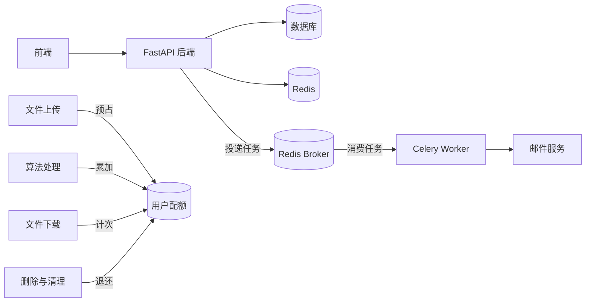
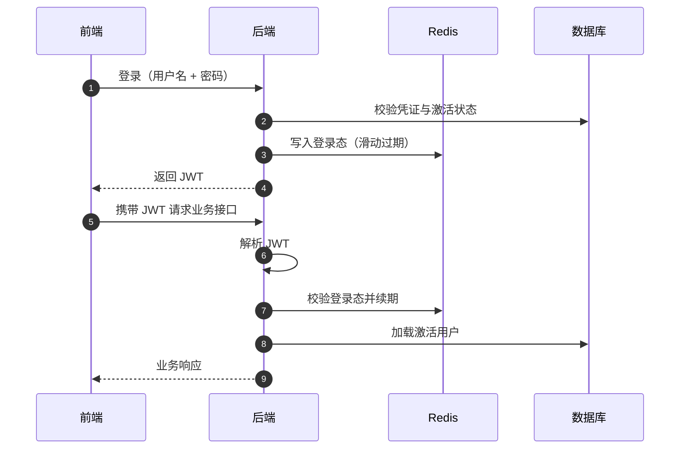

# 用户与配额业务

本文档面向新接手的开发者，介绍账号体系与配额体系。账号负责身份认证和权限分级，配额是贯穿上传、处理、下载三大业务的资源控制线：每个操作在什么时机占用配额、什么时机退还，是理解业务一致性的关键。

## 1. 业务目标

- 账号体系：注册（邮箱验证）、登录登出、资料修改、密码找回、管理员管理用户。
- 配额体系：四组限额（文件数、上传总量、处理总量、下载次数）与已用量全部记录在用户表上，随业务动作实时增减。
- 身份分级：普通用户（`user`）与管理员（`admin`），管理员拥有全局管理能力且不受下载配额限制。

## 2. 整体架构

Redis 承担两类状态：登录态（签发、续期、登出）和验证码（重置码、发送冷却）。邮件发送走 Celery 异步执行。

## 3. 核心 API

| API | 调用方 | 作用 |
|---|---|---|
| `POST /login` / `POST /logout` | 前端 | 登录签发 Token / 登出失效 |
| `POST /user_signup` | 前端 | 注册普通用户（需邮箱验证码） |
| `POST /admin_signup` | 管理员 | 创建管理员账号 |
| `POST /emailsmtprequest` | 前端 | 获取邮箱验证码（注册 / 重置 / 换邮箱） |
| `POST /password_reset` | 前端 | 凭邮箱验证码重置密码，无需登录 |
| `POST /user_change` | 前端 | 修改自己的资料，换邮箱需验证码 |
| `GET /user` | 前端 | 查询当前登录用户信息 |
| `GET /users/quota` | 前端 | 查询自己的配额用量和限额 |
| `POST /users/{user_id}/quota` | 管理员 | 调整指定用户的四项限额 |
| `POST /list_users` / `DELETE /user_delete/{user_id}` | 管理员 | 用户列表 / 删除用户 |

## 4. 账号与登录态

关键规则：

- 登录态受**双重有效期**控制：JWT 本身的签名有效期，加上服务端登录态的滑动过期。JWT 与 Redis 会话校验通过后续期登录态，再加载并校验用户激活状态，长期不活跃则自动失效。
- 登出只删除服务端登录态，Token 本身不变但立即不可用；服务端也因此具备强制下线能力。
- 未激活用户无法登录和通过鉴权。
- 注册时身份由服务端强制设为普通用户，不能自行申报管理员。
- 注册信息校验包括：邮箱唯一、职位白名单、地区代码、ORCID 真实性（异步联网校验）、主页 URL 格式。
- 删除用户仅限管理员且不能删除自己；删除后会异步清理该用户独占的全部文件资源。
- 系统启动时若不存在管理员，会按配置自动创建初始管理员并生成随机初始密码。

## 5. 邮箱验证码

注册、换邮箱和密码重置统一使用与“用途 + 邮箱”绑定的随机验证码，存入 Redis，5 分钟有效，验证成功后删除。不同用途的验证码不能混用。

关键规则：

- 重置码验证通过立即作废，错误次数超限会作废本轮并强制重新申请，防止暴力猜测和重放。
- 发送侧统一冷却限流：同一邮箱在冷却窗口内只能发一次，不区分用途。
- 防枚举：密码重置请求对“邮箱不存在或账号未激活”静默返回成功，不暴露邮箱是否注册；换绑邮箱时同样要求新验证码。
- 密码重置后登录态不受影响，旧密码立即失效。

## 6. 配额体系

四组配额的占用与退还时机：

| 配额 | 限额字段 | 占用时机 | 退还时机 |
|---|---|---|---|
| 上传文件数 | 最大文件数 | 预检建立文件关联时 +1 | 删除、解绑共享文件、过期清理时 -1 |
| 上传总大小 | 上传总量限额（GB） | 预检时按声明大小预占 | 删除或过期清理时退还 |
| 处理总量 | 处理限额（GB） | 处理成功回调时按输出大小累加 | 删除处理记录时退还 |
| 下载次数 | 下载次数上限 | 成功获得下载 URL 时 +1 | 不退还 |

关键规则（计费口径）：

- 上传按**压缩前大小**计费：预检声明值会在回调时与解包产物实际大小严格核对，不一致即判失败。
- 秒传按**被复用记录的实际大小**计费，不用客户端声明值——否则声明 1 字节即可秒传大文件绕过配额。
- 处理按**成功输出的实际大小**计费，任务失败不占用配额。
- 所有增减都是数据库原子更新，防止同一用户并发上传、删除、回调时丢失更新；递减有下限保护，不会出现负数。
- 限额调整即时生效：管理员随时可调，只更新传入的字段；上传和处理限额支持调小到低于当前用量，已占用部分不回收，但新的占用会被拒绝。
- 管理员不受下载次数限制。

## 延伸阅读

各业务中配额的具体流转见[文件上传业务](核心业务API架构-文件上传.md)、[算法处理业务](核心业务API架构-算法处理.md)和[文件下载业务](核心业务API架构-文件下载.md)。
