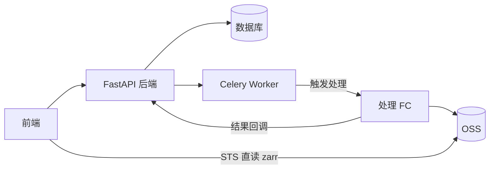
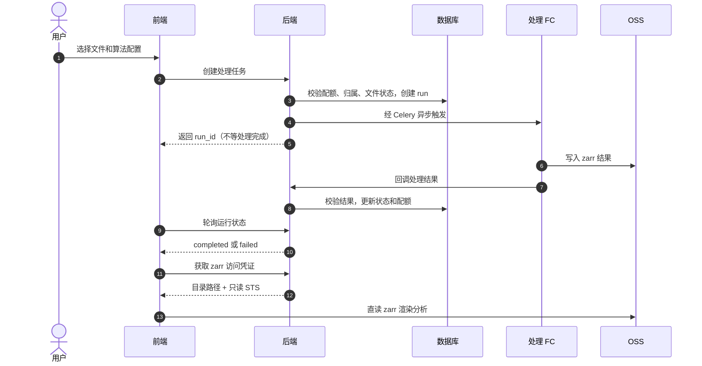
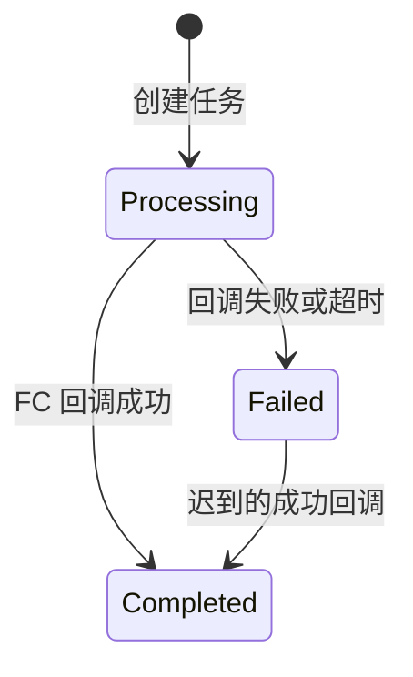

# 算法处理业务与数据分析

本文档面向新接手的开发者，介绍算法处理业务的整体流程。上传完成（`completed`）的 imzML 文件可以发起算法处理，由函数计算（FC）转换为 zarr 格式并执行预处理算法，前端再基于结果做聚类分析和可视化。上游流程见[文件上传业务](核心业务API架构-文件上传.md)。

## 1. 业务目标

算法计算不占用后端服务器资源，全部在 FC 上异步执行。后端只负责：

- 校验处理配额、文件归属和文件状态。
- 创建运行记录（run）并异步触发 FC。
- 接收 FC 回调，维护 run 状态并累加处理配额。
- 签发只读凭证，让前端直读 zarr 结果。
- 巡检超时任务，清理已删除的结果对象。

结果以 zarr 分块格式存储，每个 run 一个独立目录。前端通过 OSS SDK 随机读取分块，用于渲染质谱图像和交互式分析。

## 2. 整体架构

| 模块 | 职责 |
|---|---|
| 前端 | 提交任务、轮询状态、直读 zarr 可视化 |
| FastAPI | 配额与归属校验、run 记录、回调处理、只读凭证签发 |
| Celery | 异步触发 FC、超时巡检 |
| 处理 FC | 执行转换与算法、写 zarr、回调结果 |
| OSS | 保存 zarr 结果 |
| 数据库 | run 记录、状态和配额 |

## 3. 核心 API

| API | 调用方 | 作用 |
|---|---|---|
| `POST /processes` | 前端 | 创建算法处理任务 |
| `POST /processes/raw-convert` | 前端 | 创建 imzML 直转 zarr 任务 |
| `POST /processes/{run_id}/clustering` | 前端 | 对已完成的 run 发起聚类分析 |
| `GET /processes/mine` | 前端 | 分页查询当前用户的运行记录 |
| `GET /processes/{run_id}/zarr` | 前端 | 获取 zarr 结果目录的只读凭证 |
| `DELETE /processes/{run_id}` | 前端 | 删除运行记录并清理结果 |
| `POST /callback/algorithm_callback` | 处理 FC | 报告算法处理或直转结果 |
| `POST /callback/clustering_callback` | 处理 FC | 报告聚类结果 |

回调鉴权与上传回调一致，使用专用 Token。

## 4. 任务类型与流程

三种任务共用同一套“创建 run -> 触发 FC -> 回调更新”的骨架，区别在输入输出和触发时机：

| 任务类型 | 对应 FC | 输入 | 特点 |
|---|---|---|---|
| 算法处理 | fc-algorithm | imzML + 算法配置 | 可选执行峰检测、归一化、峰对齐、降噪、基线校正，至少选一项 |
| raw-convert 直转 | fc-raw-convert | imzML | 无算法；同文件已有完成结果时直接复用（类似上传秒传） |
| 聚类分析 | fc-clustering | 已完成的 zarr | 用户手动触发，UMAP/KMeans 结果写回源 zarr，不产生新目录 |

结合上图，几条关键规则：

- 只有 `completed` 的文件才能发起处理；处理配额在创建时检查，按累计输出大小限制。
- 创建接口立即返回 run_id，任务是否成功以数据库状态为准，FC 执行完成不等于业务完成。
- 直转结果全局复用：同文件已有完成的直转 run 直接返回原 run；有正在进行的直转任务时也不会重复创建。
- 公开文件的直转任务，任何登录用户都可以发起和查看结果。
- 聚类只对处理 `completed` 的 run 发起；重复触发是幂等的，但聚类失败不自动重试，需人工重置状态后重新触发。

## 5. 任务状态

每条 run 有两个独立的状态字段：处理状态和聚类状态（`None` 表示尚未聚类）。

| 状态 | 含义 |
|---|---|
| `processing` | 已触发 FC，等待回调 |
| `completed` | 结果路径和大小已校验落库 |
| `failed` | FC 失败、回调异常或超时 |

- 聚类状态复用同一组取值，与处理状态互相独立，聚类的开始和超时单独判定。
- 回调幂等：重复或迟到的失败回调不会覆盖终态。
- 长时间没有回调的“僵尸”任务由定时巡检标记为 failed。
- 被超时误判的 run 收到迟到的成功回调时可以翻转为 completed。

## 6. 结果访问、删除与配额

- 结果访问：`GET /processes/{run_id}/zarr` 返回结果目录和只读 STS 凭证，仅限 `completed` 的 run，权限为所有者、管理员或公开文件的直转 run；凭证有有效期并短期缓存。
- 删除 run：清理 OSS 上的结果目录，退还该 run 占用的处理配额，再删除记录；删除直转 run 会同时解除文件与默认直转结果的关联。
- 删除文件时，其全部运行记录和结果对象会一并清理。
- 处理配额按“成功输出的累计大小”计：成功回调时累加，删除 run 时退还，和上传配额同属用户配额体系。

## 延伸阅读

文件状态与 origin 就绪语义见[文件上传业务](核心业务API架构-文件上传.md)。
